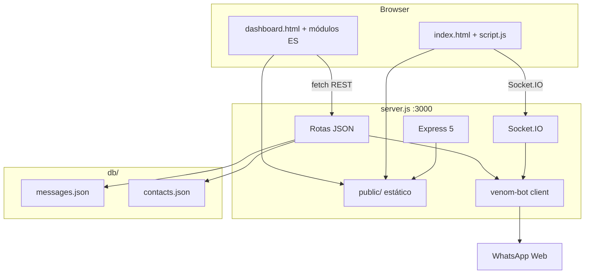
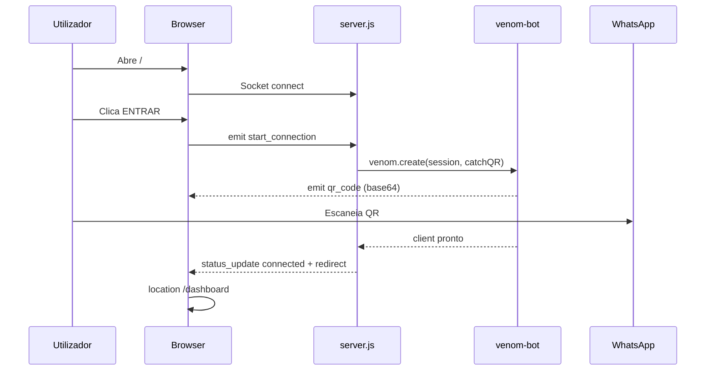
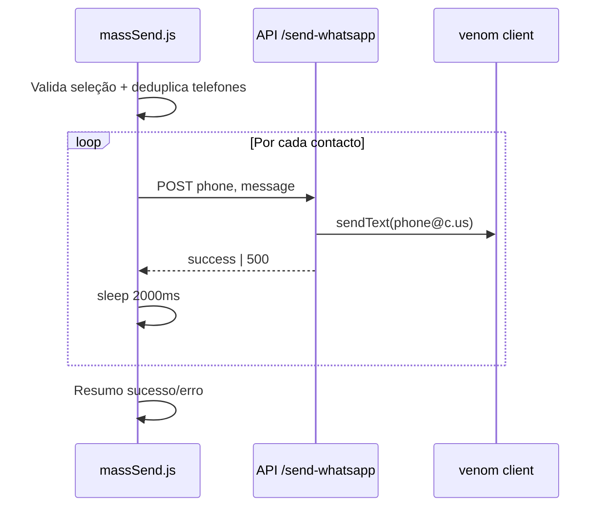

# Zappy — Documentação técnica

> Bot de envio de mensagens WhatsApp com interface web local. Este documento descreve arquitetura, fluxos, contratos HTTP/WebSocket, persistência e decisões de implementação observadas no repositório.

| Atributo | Valor |
|----------|--------|
| Versão (`package.json`) | 1.0.0 |
| Entrypoint | `server.js` |
| Runtime | Node.js 16+ (recomendado; desenvolvido com ESM em `.js`) |
| Licença | MIT |
| Porta padrão | `3000` |

---

## Índice

1. [Visão geral](#1-visão-geral)
2. [Stack e dependências](#2-stack-e-dependências)
3. [Arquitetura de alto nível](#3-arquitetura-de-alto-nível)
4. [Estrutura do repositório](#4-estrutura-do-repositório)
5. [Bootstrap e composição do servidor](#5-bootstrap-e-composição-do-servidor)
6. [Fluxos de execução](#6-fluxos-de-execução)
7. [API HTTP (REST-like)](#7-api-http-rest-like)
8. [WebSocket (Socket.IO)](#8-websocket-socketio)
9. [Modelo de dados e persistência](#9-modelo-de-dados-e-persistência)
10. [Frontend](#10-frontend)
11. [Integração WhatsApp (venom-bot)](#11-integração-whatsapp-venom-bot)
12. [Decisões arquiteturais e trade-offs](#12-decisões-arquiteturais-e-trade-offs)
13. [Estado duplicado: `server.js` vs `src/`](#13-estado-duplicado-serverjs-vs-src)
14. [Segurança e conformidade](#14-segurança-e-conformidade)
15. [Limitações conhecidas](#15-limitações-conhecidas)
16. [Operação e desenvolvimento](#16-operação-e-desenvolvimento)
17. [Evolução sugerida](#17-evolução-sugerida)

---

## 1. Visão geral

O **Zappy** automatiza o envio de mensagens via **WhatsApp Web** (protocolo não oficial), exposto através de:

- Uma **página de ligação** (`/`) que gera QR Code e estabelece sessão.
- Um **dashboard** (`/dashboard`) para CRUD de modelos de mensagem e contatos, e **envio em massa** sequencial.

O sistema é **monolítico**: um único processo Node.js serve ficheiros estáticos, API JSON e eventos Socket.IO, mantendo o cliente WhatsApp em memória (`activeSessions.client`).



---

## 2. Stack e dependências

| Pacote | Versão (package.json) | Papel |
|--------|------------------------|--------|
| `express` | ^5.1.0 | Servidor HTTP, JSON body, static files |
| `socket.io` | ^4.8.1 | Canal tempo real (QR, status de ligação) |
| `venom-bot` | ^5.3.0 | Automação WhatsApp Web (Puppeteer/Chromium headless) |
| `qrcode` | ^1.5.3 | **Declarado mas não referenciado** no código analisado |

**Módulos ES:** `server.js` e ficheiros em `src/` usam `import`/`export`. O `package.json` **não** define `"type": "module"`; em Node.js moderno, ficheiros `.js` com sintaxe ESM são tratados como módulos quando contêm `import` (comportamento dependente da versão do Node — validar no ambiente de deploy).

**Scripts:**

```json
"start": "node server.js"
"test": "echo \"Error: no test specified\" && exit 1"
```

Não há pipeline de testes, lint ou CI no repositório.

---

## 3. Arquitetura de alto nível

Padrão aplicado: **aplicação monolítica em camadas lógicas**, com separação **parcial** no frontend (módulos ES) e **refactor incompleto** no backend (`src/` não ligado ao entrypoint).

| Camada | Responsabilidade | Implementação activa |
|--------|------------------|----------------------|
| Apresentação | UI, QR, dashboard, envio em massa | `public/` |
| Transporte | HTTP + WebSocket | `server.js` (Express + Socket.IO) |
| Domínio / integração | Sessão WhatsApp, `sendText` | `venom-bot` via `activeSessions` |
| Persistência | Templates e contactos | JSON em `db/` (criado no boot) |

**Estado de sessão WhatsApp:** objecto em memória no processo — não há Redis, fila nem multi-instância.

---

## 4. Estrutura do repositório

```
Zappy/
├── server.js              # Entrypoint único (lógica completa activa)
├── package.json
├── documentation.md       # Este ficheiro
├── README.md              # Guia de utilizador (instalação/uso)
├── db/                    # Criado em runtime (messages.json, contacts.json)
├── public/
│   ├── index.html         # Ligação WhatsApp
│   ├── dashboard.html     # Gestão + envio em massa
│   ├── css/
│   └── js/
│       ├── script.js      # Cliente Socket.IO (página inicial)
│       ├── dashboard.js   # Orquestrador DOM do dashboard
│       └── modules/       # api, messages, contacts, massSend
└── src/                   # Refactor modular NÃO montado em server.js
    ├── config/session.js
    ├── utils/storage.js
    ├── routes/            # messages, contacts, whatsapp
    └── sockets/whatsapp.js
```

A pasta `db/` pode existir vazia após primeiro arranque; `readJSON` devolve `[]` se o ficheiro estiver ausente ou ilegível.

---

## 5. Bootstrap e composição do servidor

`server.js` executa, em ordem:

1. **ESM paths** — `fileURLToPath` / `__dirname` para resolver `public/` e `db/`.
2. **Express** — `express.json()`, static em `public/` com `Content-Type` explícito para `.js`.
3. **CORS permissivo** — `Access-Control-Allow-Origin: *` em todas as rotas.
4. **Estado global** — `activeSessions = { client, qrCode }` (instância local, não importa `src/config/session.js`).
5. **Helpers** — `readJSON` / `writeJSON` inline (duplicam `src/utils/storage.js`).
6. **Rotas** — páginas, CRUD mensagens/contactos, `POST /send-whatsapp`.
7. **Socket.IO** — handler `start_connection` inline (duplica `src/sockets/whatsapp.js`).
8. **Listen** — porta `3000`; garante ficheiros JSON em `db/` se não existirem.



---

## 6. Fluxos de execução

### 6.1 Ligação WhatsApp (`/`)

| Passo | Actor | Acção |
|-------|--------|--------|
| 1 | `script.js` | `socket.emit('start_connection')` ao clicar ENTRAR |
| 2 | Servidor | Fecha cliente anterior se existir; emite `waiting_qr` |
| 3 | venom | `catchQR` → `socket.emit('qr_code', base64)` |
| 4 | Utilizador | Lê QR no telemóvel |
| 5 | Servidor | `activeSessions.client = client`; emite `connected` + `redirect: true` |
| 6 | Cliente | Redireciona para `/dashboard` após 1,5 s |

**Sessão venom:** nome fixo `'whatsapp-session'`, `headless: true`, `multidevice: true`. Tokens/sessão persistidos pelo próprio venom no filesystem do processo (detalhes internos da biblioteca).

### 6.2 Gestão de mensagens e contactos

Operações via `fetch` para endpoints REST; dados ordenados no servidor (mensagens por `createdAt` descendente no GET).

### 6.3 Envio em massa



- **Throttle:** 2 segundos entre envios (`setTimeout` no cliente).
- **Normalização BR:** `validatePhoneNumbers` prefixa `55` se ≤ 11 dígitos.
- **Servidor:** remove não-dígitos e formata `phone@c.us` (JID WhatsApp).

---

## 7. API HTTP (REST-like)

Base URL usada no frontend: `http://localhost:3000` (`public/js/modules/api.js`).

| Método | Path | Body | Resposta | Notas |
|--------|------|------|----------|--------|
| `GET` | `/` | — | `index.html` | Página de ligação |
| `GET` | `/dashboard` | — | `dashboard.html` | Dashboard |
| `POST` | `/save-message` | `{ message: string }` | `{ success: true }` | `id = Date.now()` |
| `GET` | `/get-messages` | — | `Message[]` | Ordenado por data DESC |
| `POST` | `/update-message` | `{ id, text }` | `{ success: true }` \| `404` | Atualiza `updatedAt` |
| `POST` | `/delete-message` | `{ id }` | `{ success: true }` | Filtro por id |
| `POST` | `/save-contact` | `{ name, phone }` | `{ success: true }` | Sem validação de formato |
| `GET` | `/get-contacts` | — | `Contact[]` | Ordem de inserção |
| `POST` | `/delete-contact` | `{ id }` | `{ success: true }` | — |
| `POST` | `/send-whatsapp` | `{ phone, message }` | `{ success: true }` \| `500` | Requer `activeSessions.client` |

**Tipos (implícitos):**

```typescript
interface Message {
  id: number;           // Date.now() no create
  text: string;
  createdAt: string;    // ISO 8601
  updatedAt?: string;
}

interface Contact {
  id: number;
  name: string;
  phone: string;        // armazenado como digitado
  createdAt: string;
}
```

Não há paginação, versionamento de API nem OpenAPI.

---

## 8. WebSocket (Socket.IO)

| Evento (cliente → servidor) | Payload | Comportamento |
|-----------------------------|---------|---------------|
| `start_connection` | — | Inicia/reinicia venom; emite estados e QR |

| Evento (servidor → cliente) | Payload | Comportamento |
|-----------------------------|---------|---------------|
| `status_update` | `{ status, message, redirect? }` | UI de estado (`waiting_qr`, `connected`, `error`, …) |
| `qr_code` | `base64` (data URL ou raw base64) | `img#qrcode.src` |

**CDN na página inicial:** Socket.IO cliente `4.5.4` (CDN) vs servidor `4.8.1` — geralmente compatível, mas convém alinhar versões em produção.

---

## 9. Modelo de dados e persistência

**Padrão:** file-backed JSON (read-modify-write síncrono com `fs.readFileSync` / `writeFileSync`).

| Ficheiro | Conteúdo | Concorrência |
|----------|----------|--------------|
| `db/messages.json` | Array de mensagens | Sem lock; última escrita ganha |
| `db/contacts.json` | Array de contactos | Idem |

**IDs:** `Date.now()` — risco de colisão se duas criações no mesmo ms.

**Falha de leitura:** `readJSON` captura erro e devolve `[]` (ficheiro vazio/corrupto comporta-se como base vazia).

Não há migrações, backup automático nem `.gitignore` para `db/` (dados locais podem ser commitados por engano).

---

## 10. Frontend

### 10.1 Página de ligação

- **Tecnologia:** JS clássico (não módulo), Socket.IO via CDN.
- **Estado UI:** mapa `statusConfig` + handlers `status_update`, `qr_code`, `connect_error`.
- **Redireccionamento:** `data.redirect` → `/dashboard`.

### 10.2 Dashboard

- **Tecnologia:** ES modules (`type="module"`).
- **Módulos:**

| Módulo | Função |
|--------|--------|
| `api.js` | `apiRequest`, `formatPhone` (máscara display) |
| `messages.js` | CRUD UI mensagens (inline edit com `innerHTML`) |
| `contacts.js` | CRUD contactos |
| `massSend.js` | Selecção, deduplicação, loop de envio |

**`dashboard.js`:** regista `DOMContentLoaded` **duas vezes** (linhas 5–41 e 42–50) — a segunda bloco só repete a notificação de conexão; candidato a limpeza.

**Toggle listas:** usa `style.display` mas classes HTML incluem `hidden` — lógica mista (`isHidden` compara `display === 'none'`).

### 10.3 Riscos de UI

Inserção de `msg.text` em `innerHTML` sem escape → **XSS** se conteúdo malicioso for guardado como modelo de mensagem.

---

## 11. Integração WhatsApp (venom-bot)

- **Modelo:** automação do WhatsApp Web (não é Cloud API oficial Meta).
- **Implicações:** sujeito a bloqueios, ToS, quebras quando o WhatsApp altera o web client.
- **Envio:** `client.sendText(\`${digits}@c.us\`, message)`.
- **Pré-requisito:** ligação activa na mesma instância Node que recebe `POST /send-whatsapp`.

Dependência transitiva típica: Chromium/Puppeteer (peso de deploy, requisitos de SO em headless).

---

## 12. Decisões arquiteturais e trade-offs

| Decisão | Motivo provável | Trade-off |
|---------|-----------------|-----------|
| Monólito em `server.js` | Simplicidade, protótipo rápido | Difícil testar; acoplamento alto |
| JSON em disco | Zero dependência de BD | Sem transacções, sem escala horizontal |
| Socket.IO para QR | Push em tempo real sem polling | Acoplamento à mesma origem/porta |
| Estado WhatsApp em RAM | Acesso directo ao `client` venom | Reinício do processo = nova ligação QR |
| Delay 2s no envio em massa (cliente) | Reduzir rate-limit / ban heurístico | Envio lento para listas grandes |
| Prefixo `55` no cliente | Convenção Brasil | Números internacionais podem ser mal formatados |
| CORS `*` | Facilitar dev local | Inseguro se exposto à rede |
| Sem autenticação | App local single-user | Qualquer cliente na rede pode usar API se host aberto |
| Express 5 | Dependência recente | Verificar breaking changes vs tutoriais Express 4 |

---

## 13. Estado duplicado: `server.js` vs `src/`

Existe um **refactor paralelo não integrado**:

| Artefacto em `src/` | Equivalente activo em `server.js` |
|---------------------|-----------------------------------|
| `utils/storage.js` | `readJSON` / `writeJSON` inline |
| `routes/messages.js` | rotas `/save-message`, … |
| `routes/contacts.js` | rotas de contactos |
| `routes/whatsapp.js` | `POST /send-whatsapp` |
| `config/session.js` | `activeSessions` local (instância **diferente**) |
| `sockets/whatsapp.js` | handler Socket.IO inline |

**Consequência:** alterar apenas `src/` **não altera** o comportamento em produção até `server.js` importar routers e `setupWhatsappSocket(io, activeSessions)` com **uma única** fonte de `activeSessions`.

**Recomendação técnica:** ou eliminar `src/` morto, ou completar o bootstrap:

```javascript
// Esboço alvo (não implementado no repo)
import messagesRouter from './src/routes/messages.js';
import contactsRouter from './src/routes/contacts.js';
import whatsappRouter from './src/routes/whatsapp.js';
import setupWhatsappSocket from './src/sockets/whatsapp.js';
import { activeSessions } from './src/config/session.js';

app.use(messagesRouter);
app.use(contactsRouter);
app.use(whatsappRouter);
setupWhatsappSocket(io, activeSessions);
```

---

## 14. Segurança e conformidade

| Área | Estado | Severidade |
|------|--------|------------|
| Autenticação / autorização | Ausente | Alta se não-localhost |
| CORS | `*` | Média |
| Validação de input | Mínima (trim no cliente) | Média |
| XSS em templates UI | `innerHTML` com texto utilizador | Média |
| Segredos | Nenhum `.env`; sessão venom no disco do processo | Média |
| WhatsApp ToS / API oficial | Uso de automação Web | Risco de negócio/legal |
| Rate limiting servidor | Ausente | Média |

**Modelo de ameaça assumido pelo código:** operador único em `localhost` com confiança total. **Não** adequado a exposição pública sem camada de auth, HTTPS e hardening.

---

## 15. Limitações conhecidas

- Uma sessão WhatsApp por processo; sem fila de mensagens nem retry server-side.
- Envio em massa **sequencial** no browser — fechar o tab interrompe o lote.
- Sem confirmação de entrega (apenas sucesso da chamada `sendText`).
- Sem edição de contactos (apenas create/delete).
- `qrcode` npm não utilizado (QR vem do venom em base64).
- Testes: script npm falha por desenho (`exit 1`).
- `package.json` sem `"type": "module"` documentado — validar compatibilidade Node alvo.
- Ficheiros `db/*.json` vazios (0 bytes) podem causar parse error → tratado como `[]`.

---

## 16. Operação e desenvolvimento

### Instalação

```bash
git clone https://github.com/GaabDevWeb/zappy.git
cd zappy
npm install
npm start
```

### URLs

| URL | Função |
|-----|--------|
| http://localhost:3000/ | Ligação QR |
| http://localhost:3000/dashboard | Gestão e envio |

### Variáveis de ambiente

Nenhuma variável é lida no código actual; porta **hardcoded** `3000`.

### Verificação local (sem WhatsApp)

```bash
node --check server.js
```

Arranque completo requer `npm install` e interacção humana com QR.

---

## 17. Evolução sugerida

| Prioridade | Item | Critério de fecho |
|------------|------|------------------|
| P0 | Unificar `server.js` + `src/` ou remover código morto | Um único `activeSessions`; rotas montadas |
| P1 | `"type": "module"` + PORT via `process.env` | Deploy reproduzível |
| P2 | Auth (token/API key) + CORS restrito | API não aberta na LAN |
| P2 | Sanitização / `textContent` na UI | XSS mitigado |
| P3 | Fila de envio server-side + retry | Envio sobrevive a refresh |
| P3 | Testes de integração HTTP (supertest) | `npm test` verde |
| P4 | Migrar para WhatsApp Cloud API | Conformidade Meta |

---

## Referências no repositório

| Documento | Audiência |
|-----------|-----------|
| `README.md` | Utilizador final (instalação, features) |
| `documentation.md` | Engenharia (este ficheiro) |
| `.agent_history.md` | Registo de decisões do ciclo de documentação |

---

*Documentação gerada por análise estática do repositório. Comportamento em runtime depende de `npm install`, Node.js compatível com ESM e sessão venom válida.*
